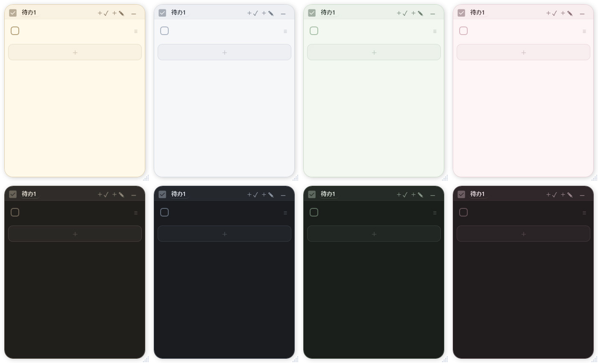

# PaPerMySelf

[English](README.md) · [贡献指南](CONTRIBUTING.md) · [更新日志](CHANGELOG.zh.md) · [架构](doc/ARCHITECTURE.md) · [仓库](https://github.com/Xioaruan912/ToDoMySelf)

PaPerMySelf 是基于 [snownico0722/PaperTodo](https://github.com/snownico0722/PaperTodo) 的 Windows 桌面粉纸应用，保留原项目的 WPF 界面、主题、控件与动画，并增加每日阅读、间隔复习、阅读同步和普通待办优先级等功能。

当前版本：**1.0.1**。



## 功能

| 范围 | 当前行为 |
| --- | --- |
| 原有 Todo / Note 纸片 | 原生桌面纸片、Markdown、撤销重做、拖拽、主题与四种界面语言 |
| 待办优先级 | 普通／中／高优先级与独立紧急标记；支持批量修改和明确排序 |
| 视觉强调 | 中优先级显示标签、浅底纹和细强调线；高优先级与紧急任务使用更强强调和加粗；已完成任务淡化 |
| 每日阅读 | 独立阅读纸片，管理论文名称、文章名称／网址、章节进度和本机笔记关联 |
| 间隔复习 | 阅读完成后启动；默认间隔 1、3、7、14、30 天；支持反馈、暂停恢复和推迟 |
| 下一步 | 阅读完成后手动安排带日期的下一步阅读 |
| 看板与设置 | 独立周统计、20 周绿格与历史；模板、复习和 WebDAV 位于原生设置页 |
| 限定同步 | 单个独占锁定的 WebDAV 阅读文档；其他纸片、笔记正文和凭据不会上传 |
| 胶囊标题 | 标题与任务正文分离；保留原项目闲置收起／悬停显示完整标题的行为 |

通常第一次复习安排在阅读完成后的第二天。完成普通待办不会生成阅读复习。

## 运行本地包

发布后，`artifacts/packages/` 中包含一个自包含 EXE、SHA-256 校验、许可声明和构建信息。

该 EXE 已内置 .NET 10 与 Windows Desktop 运行时，目标机器无需另装 .NET。请把它复制到有写入权限的专用目录使用；单文件发布版会把用户数据保存在 `%USERPROFILE%\.PaperTodo`（状态、备份和笔记图片），首次启动会把 EXE 同目录的旧数据迁移过去。开发构建仍保持可执行文件旁的便携布局。

插件是可选的，不随主程序打包。单独安装的 Web 插件可能需要 Microsoft Edge WebView2 Runtime，它与 .NET 相互独立。

## 构建与启动

需要 Windows x64、.NET 10 SDK 和 PowerShell 7.2+；同步 README 还需要 Python 3。

```powershell
# 克隆 fork 后直接构建和启动：
dotnet build PaPerMySelf.csproj -c Release
./start-dev.ps1 -Build
```

`global.json` 允许稳定版 .NET 10 的功能带更新。启动器和发布脚本优先使用 PATH 中的 dotnet，也支持 `-DotNetPath 'C:/path/to/dotnet.exe'`；仓库内的私有 SDK 目录只是回退，不是项目依赖。

开发输出位于 `输出/PaPerMySelf-v1.0.1/`。开发实例使用独立的 `PaPerMySelf` 单实例与配置命名空间，不会直接读写已安装的桌面 Todo 数据目录。

## 本地打包

```powershell
./tools/Publish-Local.ps1
```

生成唯一的 **Release / win-x64 / 自包含 / 单文件** 组合，原生依赖在运行时释放。单文件压缩、裁剪和 Native AOT 均关闭。脚本使用隔离暂存目录和白名单，排除插件与用户数据；EXE 旁附带许可声明、SHA-256 和构建信息。

此命令不会提交、推送或创建 GitHub Release。仓库中已有的 Actions 仍然可用；发布规则见 [AGENTS.md](AGENTS.md)。

## 目录结构

| 路径 | 用途 |
| --- | --- |
| `PaPerMySelf.csproj`、`src/` | 显式版本、依赖以及原生应用／业务代码 |
| `Resources/`、`assets/` | 四语言字符串、图标和原项目视觉资源 |
| `PaperTodo.Plugin.Abstractions/` | 公开插件契约 |
| `native/lmdb/`、`vendor/wpf-notifyicon/` | 原生图片存储和固定版本的托盘子模块 |
| `plugin-samples/`、`plugins/` | 插件源码／示例与开发产物；不进入主程序发布 |
| `tests/`、`tools/` | 行为检查、诊断和本地发布工具 |
| `doc/` | 当前架构、历史决策和用户指南 |
| `docs/superpowers/` | 本地工作材料，不是当前架构的权威来源 |
| `artifacts/`、`输出/` | 被忽略的打包输出与开发构建／运行数据 |

## 验证与开发

```powershell
./tools/testing/Run-Checks.ps1 -Group all -List
./tools/testing/Run-Checks.ps1 -Group regression -Project ReadingChecks
dotnet run --project tests/PaperTodo.LifecycleChecks -c Release -- --case todo-priority
./tools/testing/Run-Checks.ps1 -Group persistence
python .github/scripts/sync_readme.py --check
```

检查使用隔离数据。真实窗口／输入检查需要交互式 Windows 桌面。通过针对性检查不代表完整测试套件、多屏或混合 DPI 发布验证已经通过。

开发前请阅读 [AGENTS.md](AGENTS.md)、[架构文档](doc/ARCHITECTURE.md)、相关 [决策记录](doc/DECISIONS.md) 和当前代码。保留 StateStore 与原 Edge／纸片 ownership 边界。

## 数据与可选插件

运行数据、图片数据库、备份、插件用户状态和凭据都不应进入 Git 或发布包。单文件发布版把 `data.json`、`data.backup.json` 和 `note-assets.lmdb` 保存到 `%USERPROFILE%\.PaperTodo`；可用 `PAPERTODO_DATA_DIR` 覆盖该目录。开发构建仍把数据放在可执行文件旁。WebDAV 密码使用当前 Windows 用户的 DPAPI 加密；更换机器后需要重新配置。阅读同步只使用一个独占锁文档，不累积下载、冲突或历史副本。

可选的 Codex CLI Bridge 会创建隐藏的提示词编辑纸片，与阅读和待办优先级无关，也不随主程序单文件包分发。

## 上游与许可

基于 [snownico0722/PaperTodo](https://github.com/snownico0722/PaperTodo)。请保留 [LICENSE.md](LICENSE.md)、[THIRD-PARTY-NOTICES.md](THIRD-PARTY-NOTICES.md) 和下方原始声明。下游改动不是上游发布。

PaperTodo 使用 PolyForm Noncommercial License 1.0.0 及 PaperTodo Individual Professional Use Additional Permission 1.0。它是 source-available 许可，不是 OSI 认可的开源许可；商业使用前请阅读原始许可文本。

Required Notice: PaperTodo Copyright © 2026 snownico0722. PaperTodo is licensed under the PolyForm Noncommercial License 1.0.0 together with the PaperTodo Individual Professional Use Additional Permission 1.0, available in the original project LICENSE file at https://github.com/snownico0722/PaperTodo/blob/main/LICENSE.md. Original project: https://github.com/snownico0722/PaperTodo
